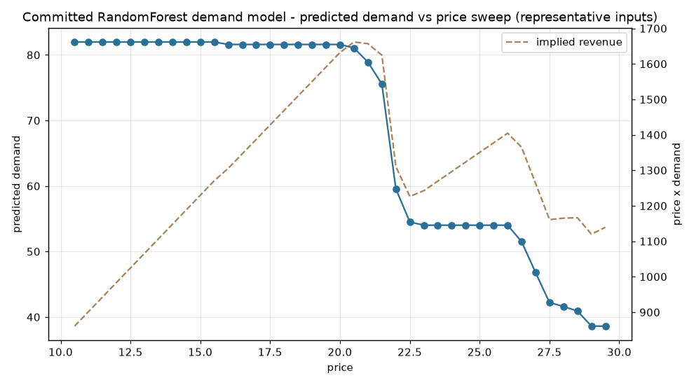
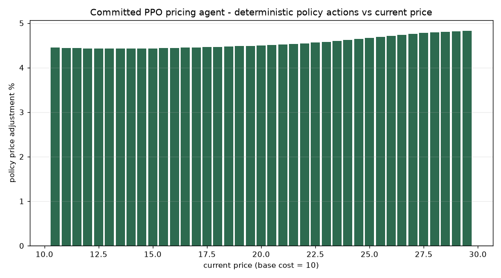

# Dynamic Pricing AI (data-mining)


University data-mining course project (hence the generic repo name): a full-stack
dynamic-pricing demo in which a demand model trained on **synthetic** sales data
drives a Gymnasium environment that a PPO agent learns to price within. A FastAPI
backend exposes the models; a Next.js dashboard shows catalog, forecasts and one-click
price application against a MySQL database.

**Read before trusting the numbers:** all sales history is generated by
`backend/setup_db.py` from a constant-elasticity demand curve
(Q = A·P^-e, Gaussian noise, seasonal bumps), so the pipeline is structurally
realistic but the "market" is synthetic. No hold-out evaluation or profit-lift
metric was recorded — see [Model evaluation](#model-evaluation).


## A real result from the committed model


*Predicted demand for a price sweep using the repository's committed RandomForest
model (`backend/models/demand_model.pkl` + `scaler.pkl`) with representative
inputs (base cost 10, competitor 12, day 100) — model is real, the input
scenario is illustrative. No database or account was used to render this.*


*Deterministic actions of the committed PPO agent (`ppo_pricing_agent.zip`) across
the same representative feature grid, exactly as `/api/optimize` queries it. The
trained policy is near-stationary: it recommends a ~+4.5% price increase for
every price in the range — honest observed behavior, not the adaptive pricer a
demo video might suggest.*

## How it works

```
MySQL (setup_db.py generates ~73,000 rows / 100 products / 730 days)
  -> train_rl.py: RandomForestRegressor on [price, competitor_price,
     day_of_year, base_cost, product_id] (StandardScaler, 50 trees, depth 10)
  -> PricingEnv (Gymnasium): the RF model is the world model; actions are
     continuous price changes in [-20%, +20%]; reward = (P - cost) x predicted demand;
     price clamped to [1.01x, 3.0x] base cost
  -> PPO (stable-baselines3, MlpPolicy, 10,000 steps, n_steps=1024, batch=64)
  -> FastAPI on :8000
  -> Next.js 16 dashboard on :3000
```

Trained artifacts are committed under `backend/models/` (`demand_model.pkl`,
`scaler.pkl`, `ppo_pricing_agent.zip`), so `uvicorn main:app` works without
retraining once the database is populated.

## Model evaluation

Stated honestly, because none was recorded:

- The Random Forest demand model is fitted on the full synthetic table; no
  train/validation split, no RMSE/R² figures exist.
- The PPO agent was trained for 10,000 environment steps ≈ 27 episodes of 365
  simulated days. That is enough to learn sensible price directionality on this
  toy simulator, not evidence of revenue improvement; no baseline comparison
  (e.g. static 1.5x-cost pricing) was run.
- Reproducing the committed artifacts: `python train_rl.py` from `backend/`
  (RF uses `random_state=42`; the PPO seed is not fixed, so agent weights will
  differ between runs).

## Requirements

- Python 3.10+, Node.js 18+ (lockfile targets Next 16; Next 16 requires Node ≥ 20 — use Node 20+), MySQL 8 reachable from the machine
- Windows: `kurulum.bat` automates the two install steps below (cmd, from the repo root)

## Setup

```bash
git clone https://github.com/ErtugrulAK/data-mining.git
cd data-mining
cp backend/.env.example backend/.env      # then edit DB_PASS
cp frontend/.env.example frontend/.env
```

`backend/.env` is loaded automatically (python-dotenv) by `main.py`,
`setup_db.py` and `train_rl.py`, from any launch directory. There is no
password default in the code any more — set `DB_PASS` in the file.

```bash
# Backend deps
cd backend
python -m venv venv
# Windows: venv\Scripts\activate   |   Linux/macOS: source venv/bin/activate
pip install -r requirements.txt

# Frontend deps
cd ../frontend
npm ci
```

```bash
# Initialize tables + synthetic data (from backend/)
cd backend
python setup_db.py

# Optional: retrain RF + PPO, overwrites models/ (few minutes, CPU)
python train_rl.py

# Start API (loads backend/models/; from backend/)
uvicorn main:app --reload --port 8000
```

Dashboard (separate terminal): `cd frontend && npm run dev`, then
http://localhost:3000. The page reads `NEXT_PUBLIC_API_URL` (default
`http://localhost:8000`) and uses only the endpoints below.

## API surface (verified against `backend/main.py`)

| Method | Endpoint | Purpose |
|---|---|---|
| `GET` | `/api/products` | product catalog |
| `GET` | `/api/product/{id}` | product + last 30 sales rows |
| `POST` | `/api/forecast` | demand/revenue/profit at a hypothetical price (RF) |
| `POST` | `/api/optimize/{id}` | PPO action → recommended price + projected profit |
| `POST` | `/api/apply_price/{id}` | write new price to DB |
| `GET` | `/api/summary` | totals, category split, 30-day trend, top 5 products |

CORS is `allow_origins=["*"]` — development setting; tighten before any real
deployment.

## Environment variables (backend)

| Variable | Default | Notes |
|---|---|---|
| `DB_USER` | `root` | |
| `DB_PASS` | – (required) | no code default; formerly a personal password, now removed from code |
| `DB_HOST` / `DB_PORT` / `DB_NAME` | `localhost` / `3306` / `dynamic_pricing` | |

## Repository notes

- `backend/main.py` previously shipped with a personal MySQL password hard-coded
  as the default value; it was also present in commits before the credential was
  moved to environment variables. Treat that password as compromised and rotate
  it if the machine is still in use.
- The repo root contains course deliverables (report PDF/DOCX, a `WhatsApp
  Image ...jpeg` pair) that include student identifiers; they are unrelated to
  running the project and can be removed from the repository (history rewrite
  required to erase — not done here).
- No automated tests and no CI. Verified flows are documented above.
- `PROJECT_DETAILS.md` is the course write-up; this README supersedes it for
  setup facts (it was written against Next 15; the lockfile says Next 16.2.4).

## License

MIT — see [LICENSE](LICENSE).
